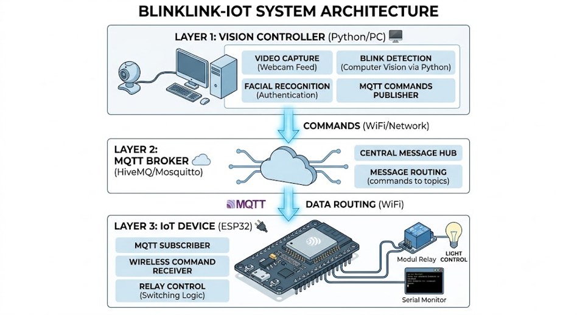

<div align="center">

# 👁️ BlinkLink

### Hands-Free IoT Control via Facial Recognition & Eye Blinks

**Empowering Independence Through Assistive Technology**

[](https://opensource.org/licenses/MIT)
[](https://www.python.org/downloads/)
[](https://opencv.org/)
[](https://www.tensorflow.org/)
[](https://mqtt.org/)

[Features](#-key-features) • [Demo](#-demo) • [How It Works](#-how-it-works) • [Installation](#-installation) • [Usage](#-usage) • [Contributing](#-contributing)

</div>

---

## 🎯 What is BlinkLink?

BlinkLink is an **innovative assistive technology system** designed to help individuals with severe motor disabilities control their environment using **only facial gestures**. By combining cutting-edge **Computer Vision**, **Machine Learning**, and **IoT technology**, BlinkLink transforms simple eye blinks into powerful commands that can control smart home devices, computers, and more.

### The Problem We're Solving

Millions of people worldwide live with conditions like ALS, cerebral palsy, or spinal cord injuries that severely limit their motor control. Traditional assistive devices often require complex setup, expensive hardware, or invasive procedures. **BlinkLink offers a non-invasive, affordable, and easy-to-use alternative** that only requires a standard webcam.

---

## 🌟 Key Features

<table>
<tr>
<td width="50%">

### 🔐 Biometric Security

- **Facial Recognition** ensures only authorized users can access the system
- Custom-trained TensorFlow model for accurate identification
- Privacy-focused: All processing happens locally on your device

</td>
<td width="50%">

### 👁️ Real-Time Gesture & Blink Detection

- High-FPS facial landmark detection using **MediaPipe Face Mesh (478 landmarks)** with fallback support for **Dlib 68-landmarks**
- **Eye Aspect Ratio (EAR) algorithm** with hysteresis filtering (anti-flicker)
- Intentional gesture recognition: distinguishes voluntary long blinks (Action trigger: ~2s, Mode switch: ~5s) from natural involuntary blinks
- Head pose estimation (Yaw/Pitch/Roll) for multi-device navigation

</td>
</tr>
<tr>
<td width="50%">

### 🌐 Wireless IoT Control

- Lightweight **MQTT protocol** for instant device communication
- Control virtually any electronic appliance via **ESP32**
- Expandable to multiple devices and rooms

</td>
<td width="50%">

### 🧩 Modular Architecture

- Clean, **object-oriented Python codebase**
- Easy to maintain, extend, and customize
- Separate modules for authentication and gesture detection

</td>
</tr>
</table>

---

## 🎬 Demo

<div align="center">

[](https://www.linkedin.com/posts/ahmad-sofi-sidik_neurotech-bci-iot-activity-7392400198737559552-Arg2?utm_source=share&utm_medium=member_desktop&rcm=ACoAAENGFPgB4uy9rK2c06iPe3EkMmylkvzKKjk)

_Watch BlinkLink in action: The system identifies the user, verifies identity, and responds to eye blinks to control IoT devices._

</div>

### What You'll See:

1. **Face Detection**: System identifies and tracks your face
2. **Authentication**: Facial recognition verifies your identity
3. **Authorization**: Green box indicates you're cleared to control devices
4. **Blink Command**: Simple eye blink triggers IoT device (light/fan/etc.)

---

## 🔬 How It Works

<div align="center">



</div>

### The Journey of a Blink

```
👤 User Blinks → 📹 Webcam Captures → 🧠 AI Processes → 📡 MQTT Publishes → 💡 Device Responds
```

1. **Vision Controller (Python/PC)** 🖥️
   - Menangkap stream kamera real-time.
   - Melakukan autentikasi pengguna lokal via FaceNet embeddings.
   - Mengekstraksi landmark mata dengan **MediaPipe Face Mesh** dan menghitung metrik EAR dengan hysteresis filter.
   - Mengirim perintah kontrol ke topik MQTT spesifik (iot/commands/lampu, iot/commands/tv, dll.).

2. **MQTT Broker (Cloud/Local)** ☁️
   - Menjadi jembatan komunikasi antara PC controller dan ESP32.

3. **IoT Device (ESP32 Hardware / Virtual Simulator)** 🔌
   - Menerima instruksi via MQTT.
   - **Kontrol Relay (GPIO 2)**: Menghidupkan/mematikan saklar listrik lampu.
   - **Kontrol IR Sender (GPIO 4)**: Memancarkan sinyal infra-merah NEC untuk mengontrol TV / STB (Volume Up/Down, Channel Up/Down).
   - Mode simulasi tersedia tanpa hardware fisik (python src/iot_devices/iot_device_virtual.py).

---

## 📊 Benchmark Results: Evaluasi Matriks Multi-Skenario

Evaluasi performa komputasi dan ketahanan ekstraksi **Eye Aspect Ratio (EAR)** antara **MediaPipe Face Mesh (478 titik)** dan **Dlib 68-Landmarks (HOG + Shape Predictor)** diuji menggunakan matriks 2x2 kondisi nyata (Pencahayaan Normal vs Low-Light, serta Tanpa Kacamata vs Dengan Kacamata) pada resolusi 1080p (total **2.932 frames**).

### 📈 Ringkasan Hasil Matriks 2x2 (Cahaya & Kacamata)

File rekapitulasi data lengkap tersimpan di [`docs/benchmarks/summary_comparison.csv`](docs/benchmarks/summary_comparison.csv).

| Skenario Pengujian | Video Input (Frames) | Pipeline / Model | Deteksi Wajah (%) | Rata-rata Latensi | Throughput (FPS) | Rata-rata EAR | Prediksi Kedip (Thresh 0.21) |
| :--- | :--- | :--- | :---: | :---: | :---: | :---: | :---: |
| **1. Normal**<br>*(Terang, Tanpa Kacamata)* | `normal.mp4`<br>(644 frames) | **MediaPipe FaceMesh**<br>Dlib 68 | **99.8%**<br>100.0% | **11.72 ms**<br>287.51 ms | **85.4 FPS**<br>3.5 FPS | **0.1698**<br>0.2484 | **6 kedipan**<br>7 kedipan |
| **2. Low-Light**<br>*(Redup, Tanpa Kacamata)* | `normal-low-light.mp4`<br>(974 frames) | **MediaPipe FaceMesh**<br>Dlib 68 | **99.9%**<br>100.0% | **11.77 ms**<br>285.84 ms | **85.0 FPS**<br>3.5 FPS | **0.1804**<br>0.2437 | **6 kedipan** *(Stabil)*<br>21 kedipan *(Flicker)* |
| **3. Kacamata**<br>*(Terang, Pakai Kacamata)* | `kacamata.mp4`<br>(328 frames) | **MediaPipe FaceMesh**<br>Dlib 68 | **99.7%**<br>100.0% | **11.95 ms**<br>288.06 ms | **83.7 FPS**<br>3.5 FPS | **0.1936**<br>0.2692 | **5 kedipan**<br>13 kedipan *(False+)* |
| **4. Kacamata + Low-Light**<br>*(Paling Ekstrem)* | `kacamata-low-light.mp4`<br>(986 frames) | **MediaPipe FaceMesh**<br>Dlib 68 | **99.9%**<br>90.5% *(Anjlok)* | **11.91 ms**<br>288.93 ms | **84.0 FPS**<br>3.5 FPS | **0.2084**<br>0.2674 | **6 kedipan** *(Sangat stabil)*<br>0 kedipan *(Gagal)* |

### 🔍 Temuan & Analisis Utama

1. **Kecepatan & Kelayakan Real-Time**: MediaPipe Face Mesh konsisten di **~84-85 FPS (latensi ~11.8 ms)** di semua kondisi, yaitu **~24.4x lebih cepat** daripada Dlib 68 (~3.5 FPS). MediaPipe memberikan ruang komputasi yang sangat lega bagi controller IoT, pygame UI, dan Flask video feed.
2. **Ketahanan Kondisi Ekstrem (Low-Light + Kacamata)**: MediaPipe mempertahankan deteksi wajah **99.9%**. Sebaliknya, Dlib 68 HOG mengalami penurunan ke **90.5%** (kehilangan wajah pada ~95 frame) akibat kombinasi bayangan gelap dan oklusi bingkai kacamata.
3. **Stabilitas Deteksi Kedip**: MediaPipe mendeteksi jumlah kedipan mata yang **sangat konsisten (~5-6 kedipan)** di seluruh skenario. Dlib rentan terhadap kedipan semu (*false positive*) saat redup/kacamata, dan gagal mendeteksi kedip sama sekali saat gelap berkacamata.
4. **Pergeseran Geometri EAR**: Keberadaan bingkai kacamata menggeser nilai rata-rata EAR sebesar +0.024 ke atas karena distorsi optik dan penarikan landmark kelopak mata. Oleh karena itu, ambang batas kedip adaptif/kalibrasi sangat direkomendasikan.

> [!NOTE]
> - **Visualisasi Grafik**: Grafik komparasi per skenario tersedia di [`docs/benchmarks/plots/`](docs/benchmarks/plots/) (`plot_normal.png`, `plot_normal_low_light.png`, `plot_kacamata.png`, `plot_kacamata_low_light.png`).
> - **Data Mentah Per-Frame**: File CSV per frame tersimpan terorganisir di [`docs/benchmarks/data/`](docs/benchmarks/data/).
> - **Hasil JSON Terstruktur**: Terdaftar lengkap pada [`docs/benchmark_results.json`](docs/benchmark_results.json).

---

### 🧪 Panduan Cara Menjalankan Benchmark Mandiri

File video pengujian tidak disertakan di repository Git (di-ignore otomatis via `.gitignore`). Anda dapat menjalankan benchmark menggunakan kamera langsung atau rekaman video Anda sendiri:

#### 1. Persiapan Dependensi
```bash
pip install -r requirements.txt
pip install psutil pandas matplotlib
```

#### 2. Menjalankan Uji Skenario Mandiri

Letakkan video Anda di root folder proyek (misal `video.mp4`), lalu jalankan:

```bash
# Skenario 1: Video Normal (Terang, Tanpa Kacamata)
python benchmark_ear.py --source normal.mp4 --frames 644   --scenario-lighting "normal" --scenario-glasses "tanpa_kacamata"   --csv-output results_normal.csv --plot-output plot_normal.png --summary-csv summary_comparison.csv

# Skenario 2: Video Low-Light (Redup)
python benchmark_ear.py --source normal-low-light.mp4 --frames 974   --scenario-lighting "low_light" --scenario-glasses "tanpa_kacamata"   --csv-output results_normal_low_light.csv --plot-output plot_normal_low_light.png --summary-csv summary_comparison.csv

# Skenario 3: Video dengan Kacamata
python benchmark_ear.py --source kacamata.mp4 --frames 328   --scenario-lighting "normal" --scenario-glasses "dengan_kacamata"   --csv-output results_kacamata.csv --plot-output plot_kacamata.png --summary-csv summary_comparison.csv

# Skenario 4: Video Kacamata + Low-Light
python benchmark_ear.py --source kacamata-low-light.mp4 --frames 986   --scenario-lighting "low_light" --scenario-glasses "dengan_kacamata"   --csv-output results_kacamata_low_light.csv --plot-output plot_kacamata_low_light.png --summary-csv summary_comparison.csv

# Menggunakan Live Webcam (Real-time kamera perangkat)
python benchmark_ear.py --source 0 --frames 300 --mode interleaved
```

> [!TIP]
> Parameter `--summary-csv summary_comparison.csv` akan secara otomatis menggabungkan ringkasan tiap skenario ke dalam satu file tabel CSV terpadu tanpa menimpa data sebelumnya.

---

## 🛠️ Technology Stack

<div align="center">

|      Category      | Technologies                                                                                                                                                                                                                                                                                                                                                    |
| :----------------: | :-------------------------------------------------------------------------------------------------------------------------------------------------------------------------------------------------------------------------------------------------------------------------------------------------------------------------------------------------------------- |
|  **AI & Vision**   |     |
| **IoT & Hardware** |                                                                                                                                                                                                                                                                    |
| **Communication**  |                                                                                                                                                                                                               |
|  **Development**   |                                                             |

</div>

---

## 🚀 Installation

### Prerequisites

**Hardware:**

- 📹 Standard USB Webcam
- 🔧 ESP32 DevKit V1 Board
- ⚡ 5V Relay Module
- � IR LED (for TV/STB control)
- 🔌 USB Cable & Jumper Wires

### Hardware Wiring (ESP32)

| Component        | ESP32 Pin |
| :--------------- | :-------- |
| **Relay Module** | GPIO 2    |
| **IR LED**       | GPIO 4    |
| **VCC**          | 5V / VIN  |
| **GND**          | GND       |

**Software:**

- 🐍 Python 3.9 or higher
- 🔧 Arduino IDE 1.8.13+
- 💻 Windows: [Visual Studio C++ Build Tools](https://visualstudio.microsoft.com/visual-cpp-build-tools/) & `CMake` (Required for `dlib`)
- 💻 Linux: `build-essential`, `cmake`, `libopenblas-dev`, `liblapack-dev`

### Step 1: Clone the Repository

```bash
git clone https://github.com/assidik12/BlinkLink-Iot.git
cd BlinkLink-Iot
```

### Step 2: Set Up Vision Controller (Python)

1. **Install Python dependencies:**

   ```bash
   pip install -r requirements.txt
   ```

2. **Download Dlib's facial landmark model:**
   - [Download here](http://dlib.net/files/shape_predictor_68_face_landmarks.dat.bz2)
   - Extract and place `shape_predictor_68_face_landmarks.dat` in the `vision_controller/` directory.

3. **Collect and Encode Your Face Data:**
   - Run the following command and follow the on-screen instructions to capture and encode your face data:

   ```bash
   python src/vision_controller/collect_face.py
   python src/vision_controller/encoded_face.py
   ```

### Step 3: Set Up IoT Device (ESP32)

1. **Install ESP32 Board in Arduino IDE:**
   - Follow this [guide](https://randomnerdtutorials.com/installing-the-esp32-board-in-arduino-ide/) to add ESP32 support to your Arduino IDE.

2. **Install Required Libraries:**
   - Open Arduino IDE, go to `Sketch > Include Library > Manage Libraries...`
   - Search for and install the following libraries:
     - `PubSubClient` by Nick O'Leary
     - `WiFi` (usually pre-installed with ESP32 board package)

3. **Configure and Upload Code:**
   - Open `iot_device/iot_device.ino` in Arduino IDE.
   - Update Wi-Fi credentials in the code:
     ```cpp
     const char* ssid = "YOUR_SSID";
     const char* password = "YOUR_PASSWORD";
     ```
   - Connect your ESP32 board, select the correct board (`ESP32 Dev Module`) and port in Arduino IDE.
   - Upload the code to the ESP32.

---

## ▶️ Usage

1. **Start the Vision Controller:**

   ```bash
   # Dari root directory project
   python run.py
   
   # Atau langsung dari src
   python src/main.py
   ```

2. **Simulation Mode (Without Hardware):**
   If you don't have an ESP32, you can run the virtual device to test the system:

   ```bash
   python src/iot_devices/iot_device_virtual.py
   ```

3. **Monitor via Web Dashboard:**
   Open `src/ui/index.html` in your web browser to view the real-time status and logs of the system.

4. **Monitor Output:**
   - Watch the terminal for logs on face detection, authentication, and device control.

5. **Interact with IoT Devices:**
   - Use configured eye blink gestures to control connected IoT devices (e.g., turn on lights, fans).

---

## ⚙️ Configuration

You can customize the system behavior by editing `src/helper/config.py`:

- **MQTT Settings**: Change `MQTT_BROKER` and topics to match your setup.
- **UI Settings**: Adjust `CAM_WIDTH`, `SCREEN_HEIGHT`, and `TARGET_FPS`.
- **Thresholds**: Sensitivity for blink detection can be tuned in the detection module.

---

## 🤝 Contributing

We welcome contributions to BlinkLink! Please follow these steps:

1. **Fork the repository**
2. **Create a new branch**: `git checkout -b feature/YourFeature`
3. **Make your changes**
4. **Commit your changes**: `git commit -m 'Add some feature'`
5. **Push to the branch**: `git push origin feature/YourFeature`
6. **Open a Pull Request**

Please ensure your code follows the existing style and includes appropriate tests.

---

## 📄 License

This project is licensed under the MIT License - see the [LICENSE](LICENSE) file for details.

---

## 📞 Contact

For questions or feedback, please reach out:

- **Ahmad Sofi Sidik** - [sofi.sidik12@gmail.com](mailto:sofi.sidik12@gmail.com)
- **LinkedIn:** [https://www.linkedin.com/in/ahmad-sofi-sidik/](https://www.linkedin.com/in/ahmad-sofi-sidik/)

---

Thank you for your interest in BlinkLink! Together, let's make technology accessible to everyone.
